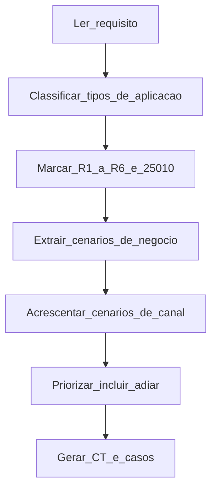

# Como identificar os cenários a testar

Este guia responde: a partir do requisito e do tipo de aplicação, **quais condições** entram no plano. A escrita de cada condição segue [05-como-escrever-um-teste.md](05-como-escrever-um-teste.md). O complemento de execução por canal está em [06-como-testar-por-canal.md](06-como-testar-por-canal.md).

## 1. Separar três listas

| Lista | O que é | Onde nasce |
|---|---|---|
| Cenário de negócio | Regra que muda saldo, status, trilha ou contrato | Requisito, independente da tela |
| Cenário de canal | O que só existe porque o usuário usa web, mobile, desktop ou API | Tipo de aplicação |
| Cenário adiado | Risco real, fora desta release | Avaliação de risco, com motivo |

Nunca invente um cenário de canal que já está coberto pelo de negócio na API, só para “ter mais casos de tela”. A tela prova a jornada; a API prova a regra.

## 2. Fluxo obrigatório de descoberta

1. Leia o item até achar efeitos observáveis.
2. Marque os tipos de aplicação impactados (pode ser mais de um).
3. Preencha a [avaliação de risco](templates/avaliacao-de-risco.md).
4. Monte a lista de negócio com as perguntas da seção 3.
5. Para cada tipo marcado, rode o inventário da seção 4.
6. Aplique a priorização da seção 5.
7. Transforme cada item incluído em condição `CT-` e caso `TC-`.

## 3. Perguntas que geram cenário de negócio

Responda por escrito. Cada “sim” com efeito diferente vira pelo menos uma condição.

| Pergunta | Se sim, gere condição de |
|---|---|
| Qual valor, status ou registro muda? | Caminho feliz com oráculo |
| Quais limites (valor, data, quantidade, alçada)? | Último aceito e primeiro recusado |
| Quais combinações de regra (tipo de conta × canal × horário)? | Tabela de decisão — uma condição por resultado distinto |
| A entidade tem ciclo de vida? | Transição permitida e uma proibida |
| Quem pode e quem não pode? | Papel autorizado e papel negado |
| A operação pode ser repetida? | Idempotência / duplicidade |
| Há sistema externo? | Sucesso, timeout, rejeição, retentativa |
| Pode falhar no meio? | Recuperação sem débito órfão nem duplicata |
| É cadastro mestre? | CRUD + restrição de exclusão com vínculo |

## 4. Inventário por tipo de aplicação

Marque o tipo real. Depois percorra só as listas marcadas.

### 4.1 API / serviço

**Como inventariar**

1. Liste operações HTTP (ou mensagens) que a mudança toca: método, caminho, evento.
2. Para cada operação, copie a matriz abaixo e risque o que não se aplica, com motivo.
3. Cada linha que sobrar vira candidato a `CT-`.

| ID local | Situação | Incluir? |
|---|---|---|
| A1 | Sucesso com efeito de negócio | |
| A2 | Último valor / estado aceito | |
| A3 | Primeiro valor / estado recusado | |
| A4 | Campo obrigatório ausente | |
| A5 | Formato inválido | |
| A6 | Sem autenticação | |
| A7 | Papel sem alçada | |
| A8 | Token / sessão de outro titular | |
| A9 | Mesma chave de idempotência | |
| A10 | Dependência externa indisponível | |
| A11 | Repetição após resposta duvidosa | |
| A12 | Consulta do efeito persistido (não só o HTTP) | |

**Prioridade:** A1, A2, A3, A8, A9 e A12 são quase sempre obrigatórios em R1/R3. A4–A7 entram se a operação grava ou autoriza.

### 4.2 Web (navegador desktop)

**Como inventariar**

1. Liste as telas e os fluxos que o requisito altera (URL ou menu).
2. Confirme se a regra já terá caso de API. Se sim, a web só precisa das jornadas abaixo, não da tabela de tarifa inteira.
3. Preencha:

| ID local | Situação | Incluir? |
|---|---|---|
| W1 | Jornada feliz ponta a ponta do papel principal | |
| W2 | Validação de tela que impede envio indevido | |
| W3 | Mensagem / estado após erro de negócio da API | |
| W4 | Sessão expirada no meio do fluxo | |
| W5 | Teclado / ordem de tabulação na operação crítica | |
| W6 | Dois papéis com menus diferentes (se houver) | |

**Prioridade:** W1 sempre que houver tela. W3 e W4 quando R4 ou R5. W5 quando posto de agência. Demais regras ficam na API.

### 4.3 Desktop nativo / terminal / emulação

**Como inventariar**

1. Identifique versão do cliente, posto e se a mudança é de regra, de tela ou de instalador.
2. Regra de negócio → continue inventariando API (ou serviço batch) primeiro.
3. Acrescente:

| ID local | Situação | Incluir? |
|---|---|---|
| D1 | Operação crítica só com teclado | |
| D2 | Foco após erro de validação | |
| D3 | Resolução / monitor do posto | |
| D4 | Bloqueio por inatividade no meio da confirmação | |
| D5 | Instalação / atualização / rollback da versão | |
| D6 | Exportação ou impressão com identificador da transação | |
| D7 | Dois operadores na mesma pendência | |

**Prioridade:** D1 e D4 em operação de agência. D5 só se a release empacota cliente. Automação oficial: manual, salvo Electron (Playwright) ou exceção.

### 4.4 Mobile web

**Como inventariar**

1. Confirme que é site no navegador do telefone, não app de loja.
2. Reuse W1 da web em viewport mobile; não duplique toda a matriz de API.

| ID local | Situação | Incluir? |
|---|---|---|
| MW1 | Jornada crítica em viewport do parque (ex.: 390×844) | |
| MW2 | Campo de valor não fica sob o teclado | |
| MW3 | Recarregar / voltar no meio da confirmação | |
| MW4 | Rede lenta ou timeout com mesma regra de idempotência | |
| MW5 | Repetir MW1 uma vez em aparelho físico (se R6 alto) | |

### 4.5 App nativo

**Como inventariar**

1. Liste telas e gestos do fluxo alterado.
2. Negócio na API; app prova conclusão e interrupção.

| ID local | Situação | Incluir? |
|---|---|---|
| N1 | Jornada feliz no aparelho de referência | |
| N2 | App em segundo plano antes de confirmar | |
| N3 | Negar permissão essencial e recuperar | |
| N4 | Orientação suportada pelo app | |
| N5 | Versão mínima suportada | |
| N6 | Rede fraca / retry sem duplicar | |

**Prioridade:** N1 e N2 em qualquer release que mexe na confirmação. N3 se usa câmera, biometria ou localização. Automação oficial: Appium 2 + WebdriverIO ([13-padrao-appium-wdio.md](13-padrao-appium-wdio.md)). Manual permanece válido para aparelho novo ou fluxo ainda não automatizado.

### 4.6 Batch / job / arquivo

| ID local | Situação | Incluir? |
|---|---|---|
| B1 | Lote que processa com sucesso | |
| B2 | Registro inválido isolado sem abortar o lote inteiro (se a regra for assim) | |
| B3 | Reprocessamento do mesmo arquivo / chave | |
| B4 | Data de corte | |
| B5 | Tempo de janela (aí entra k6 ou medição de duração) | |

### 4.7 Usabilidade (capacidade de interação)

Só se R6 ou capacidade de interação estiver marcada. Inventário = tarefas, não cliques.

| ID local | Situação | Incluir? |
|---|---|---|
| U1 | Tarefa crítica do papel, sem ajuda do facilitador | |
| U2 | Recuperar de erro de validação | |
| U3 | Cancelar antes de confirmar sem gerar lançamento | |

## 5. Priorizar: incluir, automatizar ou adiar

| Critério | Decisão |
|---|---|
| Classe R1, R2 ou R3 e efeito nesta release | **Incluir** como `CT-` / `TC-` |
| Só canal, e a regra já está na API | **Incluir** no máximo a jornada (W1 / MW1 / N1); adiar o resto de canal se o prazo apertar |
| Sem efeito observável no requisito | **Devolver** ao refinamento; não inventar cenário |
| Risco real, fora do incremento | **Adiar** com motivo na avaliação de risco |
| Determinístico e permanente | **Automatizar** no nível certo (API primeiro) |
| Julgamento humano (usabilidade) | **Manual** com charter |
| App nativo com jornada estável | **Automatizar** com Appium+WDIO; manual só o que ainda não tem script |

Ordem de inclusão quando o tempo acaba: negócio R1 → R2 → R3 → jornada do canal principal → demais canais → usabilidade → desempenho (k6).

## 6. Saída obrigatória da identificação

Antes de escrever passos detalhados, publique:

1. Avaliação de risco preenchida.
2. Tabela:

| ID candidato | Lista (negócio/canal) | Tipo app | Classe | Incluir / adiar | Automatizar? | Vira CT- |
|---|---|---|---|---|---|---|
| | | | | | | |

3. Lacunas do requisito (perguntas sem resposta) — bloqueiam só os cenários dependentes, não a identificação inteira.

## 7. Exemplo rápido — “transferência também no app”

Requisito: cliente transfere entre contas no app; mesma regra do internet banking.

| Candidato | Decisão |
|---|---|
| Negócio: valor ok, limite, idempotência, outro titular | Incluir na **API** |
| N1 jornada no aparelho | Incluir **app nativo** (Appium ou manual se suíte ainda não existe) |
| N2 segundo plano na confirmação | Incluir (Appium) |
| W1 web | Adiar se a release não mexe na web |
| Matriz inteira de validação de campo na tela do app | Adiar — fica na API |

Resultado: vários `CT-` de API + dois de app. Não vinte casos de tela repetindo a tarifa.
