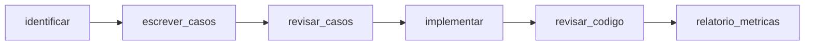

# Agentes no Cursor para o padrão de qualidade

Skills em `.cursor/skills/`. Cada skill tem `SKILL.md`, `reference.md` e (quando aplicável) `examples.md`. Glossário único: [`_shared/glossario-padrao.md`](../../.cursor/skills/_shared/glossario-padrao.md).

| Skill | Quando usar | Handoff de saída |
|---|---|---|
| `identificar-cenarios-teste` | Requisito / o que testar | `HANDOFF_IDENTIFICACAO` |
| `escrever-casos-do-padrao` | Detalhar CT-/TC- | `HANDOFF_CASOS` |
| `revisar-casos-teste` | Review de casos manuais antes de automatizar | `HANDOFF_REVIEW_CASOS` |
| `implementar-automacao-teste` | Codificar a partir do TC- | `HANDOFF_IMPLEMENTACAO` |
| `revisar-automacao-teste` | Code review / antes do PR | `HANDOFF_REVIEW_CODIGO` |
| `gerar-relatorio-metricas` | Fechamento release / M1–M4 | `HANDOFF_RELATORIO` |

Rules:

- `qualidade-identificar-cenarios.mdc`
- `qualidade-automacao.mdc`
- `qualidade-casos-e-relatorio.mdc`

## Fluxo e handoff



```text
Requisito
  → identificar-cenarios-teste     → HANDOFF_IDENTIFICACAO
  → escrever-casos-do-padrao       → HANDOFF_CASOS
  → revisar-casos-teste            → HANDOFF_REVIEW_CASOS
  → Azure Test Plans + revisão humana (R1–R4)
  → implementar-automacao-teste    → HANDOFF_IMPLEMENTACAO
  → revisar-automacao-teste        → HANDOFF_REVIEW_CODIGO
  → gerar-relatorio-metricas       → HANDOFF_RELATORIO
```

O agente **lê** `reference.md` e, se houver dúvida de formato, `examples.md` da skill. Reporta auto-checagem. Não inventa métricas nem implementa código sem `TC-`.

## Como chamar

1. “Use identificar-cenarios-teste neste requisito.”
2. “Com o HANDOFF_IDENTIFICACAO, escreva os casos (escrever-casos-do-padrao).”
3. “Revise os TC- com revisar-casos-teste.”
4. “Implemente TC-CORE-… com implementar-automacao-teste.”
5. “Revise o código com revisar-automacao-teste.”
6. “Com estes números do Test Run, gere o relatório (gerar-relatorio-metricas).”

## Boas práticas humanas

- Um requisito por conversa.
- Validar handoffs antes de pular etapas.
- R1–R4: revisão humana além do agente de casos.
- Flaky: fora da suíte que bloqueia no mesmo dia (M4).
